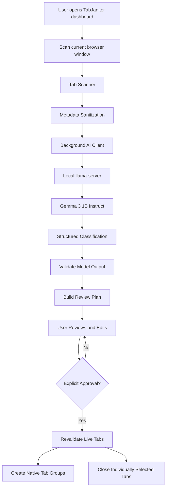

# TabJanitor 🧹
### Less Tabs. More Focus.

**TabJanitor** is a local-first AI-powered browser tab organizer that turns tab chaos into a structured workspace. It uses **Gemma 3 1B running locally through `llama.cpp`** to classify open tabs, then lets you review and edit the proposed organization before making any browser changes.


No accounts. No cloud AI API. No automatic tab closures.

**Status: backend and frontend integrated.** The dashboard is a real extension page: it asks the
service worker for status, scans the current window through `SCAN_TABS`, sends every category and
closure edit to `UPDATE_REVIEW_PLAN`, and applies only after `APPLY_ORGANIZATION` with your explicit
approval. No sample data is used on any production path — outside an extension page the dashboard
says so and keeps the scan and apply buttons disabled. See
[Frontend](#frontend-connected-to-the-service-worker) and
[`frontend/scripts/source.js`](frontend/scripts/source.js).


> **Core principle:** AI recommends. You review. You decide what changes.


## ✨ Features

1. **Start scan** — the frontend asks for `SCAN_TABS`. Only the current window is read.
2. **Minimal metadata** — per tab: a local reference number, a truncated title, the sanitized URL
   (query, fragment and credentials removed) and the hostname. `chrome://` and similar pages are
   excluded from classification. No page content, cookies, storage or history is read.
3. **Classify with Gemma** — one chat-completions request per eligible tab against the configured
   local endpoint; the reply must be JSON.
4. **Validate and build the review plan** — categories, confidence range, ref correspondence,
   duplicates and unknown refs are checked against the trusted local snapshot; counts are computed
   locally. Nothing changes in the browser during this stage.
5. **User review** — the plan is editable: move tabs between categories, tick individual tabs for
   closure. Every edit is debounced and sent to the session as `UPDATE_REVIEW_PLAN`, so the worker
   holds the plan that will actually be applied — in memory that survives the worker being stopped and
   restarted. The AI's original answer stays in `originalCategory`.
6. **Apply** — only after `APPLY_ORGANIZATION` with an explicit `approve: true`. The dashboard first
   flushes any unsent edit and refuses to apply while one is still pending or was refused, then checks
   that the review is still live before anything is approved. Tabs are
   re-checked against the live window, groups are created with `chrome.tabs.group` /
   `chrome.tabGroups.update`, and only individually selected tabs are closed.


- **AI-powered tab classification** — organize tabs into Development, Study, Research, Shopping, Entertainment, Other, and Junk / Review.
- **Local Gemma inference** — run classification on your own machine using `llama-server`.
- **Human-in-the-loop workflow** — inspect classifications, change categories, and choose individual tabs to close.
- **Native browser tab groups** — apply approved categories as browser groups.
- **Privacy-first metadata handling** — send only limited, sanitized tab metadata to the local model.
- **Light and dark themes** — switch between themes in the dashboard.
- **Explicit approval** — no grouping or closing tabs during scanning or review.

## 🧠 How Gemma Is Integrated


TabJanitor uses **Gemma 3 1B Instruct in GGUF format**, served locally by `llama.cpp` through its `llama-server` executable.

Gemma acts as the classification component of the application. It receives limited metadata about an eligible tab and returns a structured classification that the extension validates before using it to build a review plan.

### Inference pipeline

1. **Prepare metadata:** the extension collects the tab title and URL-related metadata, removes query parameters and fragments from the URL, and applies length limits.
2. **Send a local inference request:** the extension's background service worker sends a request to the local OpenAI-compatible chat-completions endpoint.
3. **Classify:** Gemma proposes a category and a concise explanation, along with the structured fields required by the classifier.
4. **Validate:** application code checks the response structure, allowed categories, confidence values, and tab references. Invalid or incomplete model output must not be blindly trusted.
5. **Build the plan:** the extension creates the review plan and calculates its counts locally.
6. **Wait for approval:** the user reviews and adjusts the plan before applying any changes.

### Why use a local model?

Running Gemma locally avoids depending on a hosted AI API for classification. TabJanitor does not require an OpenAI API key or a cloud inference account for its local model workflow.

The model is not responsible for executing browser actions. **Gemma proposes classifications; the extension's trusted code controls tab grouping and closure.**

## 🏗️ Architecture



### Main components

```
manifest.json                 MV3 root: module service worker, action (no popup), loopback hosts
package.json                  workspace manifest — marks both folders as ESM, runs the whole suite
backend/
  background/
    service-worker.js         message entry point, trusted-sender check, toolbar-icon dashboard
    message-handler.js        SCAN_TABS / GET_REVIEW_PLAN / UPDATE_REVIEW_PLAN / APPLY_ORGANIZATION / GET_STATUS
    tab-scanner.js            current-window snapshot, local refs, session id
    metadata.js               scheme filtering, URL sanitization, length limits
    ai-client.js              configuration, validation, readiness, OpenAI-compatible chat completions
    classifier.js             prompt, JSON extraction, model-output validation
    review-plan.js            plan construction, user edits, local counts
    organizer.js              live re-validation, grouping, naming, explicit closures
    session-store.js          the review in memory-only session storage, so a restarted worker can still apply it
  shared/
    constants.js              categories, colours, limits, message types, error codes, status values
    schemas.js                envelope helpers and field validators
  tests/                      mocked unit tests + a manual live smoke test
  docs/API_CONTRACT.md        request/response contract for the frontend
  config/config.example.json  example inference configuration
  tools/serve-frontend.js     dev-only static server so the page can run over http://
  tools/logo-trace.html       re-traces the logo artwork into the icons.js path (open it in a browser)
frontend/
  dashboard.html              the dashboard page (extension page opened by the toolbar icon)
  styles/tokens.css           design tokens: light + dark themes, nothing else holds a colour
  styles/dashboard.css        layout and components, mobile-first
  scripts/dashboard.js        controller: status → scan → review → sync → apply, event wiring
  scripts/source.js           THE INTEGRATION BOUNDARY: the only module that sends messages
  scripts/review-sync.js      edit synchronization: debounce, coalesce, retry, session-loss gating
  scripts/selectors.js        derived counts, filtering, distribution
  scripts/theme.js            theme state, chrome.storage.local with a localStorage mirror
  scripts/components/         sidebar, status header, banner, summary, cards, table, panels, dialog
  scripts/store.js            tiny state container (pub/sub)
  scripts/dom.js              DOM helpers, event delegation, focus preservation
  scripts/icons.js            inline SVG icons + the traced brand mark
  scripts/theme-boot.js       pre-paint theme read; a classic script on purpose, not a module
  scripts/mock-data.js        test fixture only — not imported by the dashboard
  tests/                      boundary, adapter, sync and message-flow tests
  assets/tabjanitor-logo-source.jpg  brand artwork; the SVG in icons.js is traced from it
```

Only `frontend/scripts/source.js` calls `chrome.runtime.sendMessage`; only
`backend/background/service-worker.js` calls it back through `message-handler.js`, over the documented
envelope (`{ ok: true, data }` / `{ ok: false, error: { code, message, details } }`). No dashboard
module uses `fetch`, and no component touches `chrome.tabs` — grouping and closing happen only in
`organizer.js`, and only after approval. `frontend/tests/boundary.test.js` enforces those rules
statically so they cannot drift back.


| Component | Responsibility |
|---|---|
| `manifest.json` | Declares the Manifest V3 extension, service worker, permissions, and local endpoint access. |
| `background/service-worker.js` | Entry point for extension messages and trusted-sender checks. |
| `background/message-handler.js` | Handles status, scanning, review-plan updates, and approved application requests. |
| `background/tab-scanner.js` | Reads the current window's tabs and creates the scan snapshot. |
| `background/metadata.js` | Filters unsupported URL schemes, sanitizes metadata, and enforces limits. |
| `background/ai-client.js` | Validates local model configuration, checks readiness, and sends inference requests. |
| `background/classifier.js` | Constructs the classification request and validates model output. |
| `background/review-plan.js` | Builds and updates the editable review plan and calculates counts. |
| `background/organizer.js` | Revalidates live tabs and performs approved grouping and closures. |
| `background/session-store.js` | Keeps the current review in memory-only session storage across a service-worker restart. |
| `shared/constants.js` | Defines categories, limits, message types, and error/status codes. |
| `shared/schemas.js` | Provides request/response helpers and field validation. |
| `frontend/` | Contains the dashboard, theme system, UI components, state handling, and frontend integration boundary. |

### Frontend–backend communication

The dashboard communicates with the extension service worker through `chrome.runtime.sendMessage()`. The background layer owns access to browser tabs and the local inference endpoint.

The request/response contract uses a consistent envelope:

- Success: `{ "ok": true, "data": {} }`
- Failure: `{ "ok": false, "error": { "code": "...", "message": "...", "details": {} } }`

This separation keeps UI components from directly executing browser actions or sending tab metadata to the model endpoint.

## 🔄 The User Workflow

### 1. Check model status

Open TabJanitor from the browser's extension toolbar. The dashboard checks whether the extension can communicate with the local inference service.

Scanning should remain unavailable if the required model checks fail.

### 2. Scan the current window

Start a scan to collect eligible tabs from the current browser window. TabJanitor does not scan every browser window automatically.

### 3. Review the AI-generated plan

Inspect the proposed categories, tab titles, domains, explanations, and summary counts. Unsupported browser pages are excluded from model classification.

### 4. Correct the plan

Move tabs into different categories as needed. Select individual tabs for closure only when you are sure they are no longer needed.

`Junk / Review` is a suggestion to inspect a tab, not an instruction to close it.

### 5. Apply the organization

Confirm the action through the dashboard's approval flow. The extension rechecks the relevant tabs and then attempts to create native tab groups and close only the tabs explicitly selected for closure.

If some operations fail, the application should report the partial result rather than claiming everything succeeded.

## 🔒 Privacy and Safety

TabJanitor is designed to keep classification local and browser actions under user control.

- **Local inference:** the configured model endpoint must use `127.0.0.1` or `localhost`.
- **Minimal metadata:** the model receives sanitized tab metadata, not full webpages.
- **No page-content scraping:** TabJanitor does not need page contents, cookies, browser storage, or browsing history for its classification workflow.
- **No remote inference endpoint:** the application validates the endpoint configuration and rejects non-loopback endpoints.
- **No automatic closures:** the model cannot close tabs. Closure requires explicit user selection and approval.
- **Live revalidation:** the extension rechecks tab IDs and window membership before applying changes.
- **Validated model output:** model-generated data is treated as untrusted input and checked by application code.

The extension requests these browser permissions:

| Permission | Purpose |
|---|---|
| `tabs` | Read tab titles and URLs and perform approved tab operations. |
| `tabGroups` | Create and name native tab groups. |
| `storage` | Store the local inference configuration and the dashboard theme, and keep the review you are looking at in memory-only session storage while Chrome is running. |
| Localhost host permissions | Communicate with the local inference server. |

**Privacy scope:** tab metadata is sent to the configured local inference server. This design does not independently audit the operating system, model binary, or other software running on the machine.

## ⚙️ Setup and Usage

### Requirements

- Google Chrome with support for Manifest V3.
- The TabJanitor repository.
- `llama-server` from `llama.cpp`.
- A compatible local Gemma GGUF model.
- A machine capable of running the selected model.

### 1. Start the local Gemma server

Make sure your GGUF model is available locally and `llama-server` is installed.

Example PowerShell command for the verified local setup:

```powershell
& "$env:LOCALAPPDATA\Microsoft\WinGet\Packages\ggml.llamacpp_Microsoft.Winget.Source_8wekyb3d8bbwe\llama-server.exe" `
  --model "$env:USERPROFILE\.cache\huggingface\hub\models--ggml-org--gemma-3-1b-it-GGUF\snapshots\f9c28bcd85737ffc5aef028638d3341d49869c27\gemma-3-1b-it-Q4_K_M.gguf" `
  --host 127.0.0.1 `
  --port 8080 `
  --ctx-size 4096
```


This command uses the model path from the original development environment. If you use a different installation or model location, update the paths accordingly.

The endpoint interface is llama.cpp's OpenAI-compatible chat completions (`/v1/chat/completions`),
which is exactly what `backend/background/ai-client.js` calls. Ollama is not used and not required.


The server exposes an OpenAI-compatible chat-completions endpoint at:

`http://127.0.0.1:8080/v1/chat/completions`

TabJanitor uses this local endpoint; Ollama is not required for this setup.


### 2. Verify the server

- `inferenceEndpoint` must be an `http` base URL on `127.0.0.1` or `localhost`, with no path, query or
  credentials. It is validated before any request, and a non-loopback value is refused with
  `CONFIG_MISSING` — the extension cannot be pointed at a cloud endpoint by configuration alone.
- `inferenceModel` is the identifier sent in the request. llama.cpp reports the loaded model at
  `/props` (`model_alias` / `model_path`). `gemma-3-1b-it` was verified to be accepted by this
  server; check `/props` after loading a different model.
- If nothing is stored, the code falls back to the verified local defaults (`http://127.0.0.1:8080`,
  `gemma-3-1b-it`). That default is a convenience for this local setup, still overridable at runtime.
- `backend/config/config.example.json` mirrors the same shape for the Node smoke test.
  Machine-specific values belong in `backend/config/config.local.json`, which is gitignored.


In PowerShell, run:

```powershell
Invoke-RestMethod http://127.0.0.1:8080/health
```

The server should report a healthy status. You can also inspect the loaded model:


```powershell
Invoke-RestMethod http://127.0.0.1:8080/props |
  Select-Object model_alias, model_path, model_ftype
```

A healthy endpoint alone does not guarantee that classification requests will succeed; TabJanitor also checks whether the model can answer a test request.

### 3. Load the extension in Chrome

1. Open `chrome://extensions`.
2. Enable **Developer mode**.
3. Select **Load unpacked**.
4. Choose the TabJanitor project folder containing `manifest.json`.
5. Pin TabJanitor to the browser toolbar if needed.
6. Click the TabJanitor icon to open its dashboard.

### 4. Use TabJanitor

## Permissions

- `tabs` — read the current window's tab titles and URLs, and create/close tabs.
- `tabGroups` — create and name native groups.
- `storage` — read the inference endpoint/model from `chrome.storage.local`.
- `host_permissions: http://127.0.0.1/*, http://localhost/*` — loopback only, so the service worker
  may reach a local inference server on any port. No broad host permissions are requested.

llama.cpp answers CORS with `--cors-origins` defaulting to `*`, which works from the extension
origin. If you restrict it, include `chrome-extension://<your unpacked extension id>`.

Privacy note: the validation above and the loopback-only `host_permissions` together mean tab
metadata cannot be sent anywhere but this machine — a remote `inferenceEndpoint` is rejected by the
client before a request is made, and the manifest does not grant the extension any other host. No key is
needed for the local path, and no credential is ever committed.

## Frontend (connected to the service worker)

The dashboard recreates the reference design: cream graph-paper surfaces, neo-brutalist borders and
hard offset shadows, a Bodoni-class display serif over Inter, pastel folder cards, and a real light
and dark theme. It is a plain HTML + CSS + ES-module page with no build step and no dependencies,
matching the rest of the repository.

```bash
npm run serve:frontend   # http://127.0.0.1:4173/frontend/dashboard.html — styling only, no worker
```

That URL serves the page over `http://`, so it cannot reach a service worker; it is the way to check
layout, themes and components, and it is not the extension workflow.

### Entry point

`manifest.json` declares an `action` with **no** `default_popup`, so `chrome.action.onClicked` fires
and `backend/background/service-worker.js` opens `frontend/dashboard.html` with
`chrome.runtime.getURL` + `chrome.tabs.create`. Clicking the icon again focuses the dashboard tab that
is already open instead of stacking copies. The same listener that answers the dashboard's messages is
the one that existed before, with the trusted-sender check intact: a message whose `sender.id` is not
this extension, or whose `sender.url` is not an extension-owned document, is refused with
`UNTRUSTED_SENDER` before any handler or any `fetch` runs.

### The data flow the page runs

1. **On load** — `getStatus()` sends `GET_STATUS`; the badge shows `ready`, `config_missing`,
   `endpoint_unreachable`, `model_request_failing`, or a page-side failure (`not_extension`,
   `worker_unavailable`, `invalid_response`). Scan stays disabled unless the worker itself returns
   `canScan: true` with a status it defines. "Re-check" re-sends the message; it never reuses a cached
   answer.
2. **Scan Window** — `scan()` sends `SCAN_TABS` and renders the plan the worker returns: rows,
   category counts, unclassified, unsupported, truncated and rejected, plus the real model metadata
   (request count, server-reported model, tokens/s, finish reason, failed requests).
3. **Review** — every category change and closure tick goes through `review-sync.js`: edits are
   coalesced per tab, debounced, and sent as `UPDATE_REVIEW_PLAN` with the documented `moves` /
   `closures` payload. The sync panel shows `clean / pending / syncing / failed / session_lost`, and
   offers Retry or Re-read plan. A refused edit is kept on screen, marked unsynced, and blocks Apply —
   it is never silently dropped.
4. **Apply** — the dialog states what will happen in this window. Confirming flushes pending edits
   first and aborts if anything is unsynced, then asks the worker to confirm it still holds this
   review (`GET_REVIEW_PLAN`) before anything is approved — a review that has gone is reported in the
   dialog instead of as a late toast. Only then does `applyOrganization()` send `APPLY_ORGANIZATION`
   with `approve: true`. The result dialog reports the worker's real outcome, including
   `PARTIAL_APPLY_FAILURE` with the per-operation failures from `error.details`. After any apply the
   session is marked spent, so the same review cannot be applied twice.
5. **Session lifetime** — Manifest V3 stops an idle service worker and its memory goes with it, so the
   snapshot and the plan are mirrored to `chrome.storage.session` on every scan and every accepted
   edit, and read back before any request that names a session. Session storage is memory-only: it is
   never written to disk, and Chrome clears it when the browser closes or the extension reloads. A
   worker that restarts while you review therefore still applies the same plan; a reload or a browser
   restart does not, and `STALE_TABS`/`INVALID_REQUEST` moves the review to `session_lost` — editing
   continues locally, no more messages are queued, Apply is blocked, and the page tells you to scan
   again. A spent review is removed from storage by its own apply, so it cannot come back.

**What deliberately does not happen:** no `fetch` anywhere in `frontend/`, no `chrome.tabs` /
`chrome.tabGroups` / `chrome.windows` call in any UI module, and no classification, validation or
counting logic duplicated from the backend. `source.js` is the only module that touches
`chrome.runtime`, and `frontend/tests/boundary.test.js` fails the suite if that stops being true.
When the page is opened over `http://` instead of as an extension page it says
**Not an extension page**, keeps Scan blocked and Apply disabled, and shows an empty review — it does
not fall back to sample data.

Everything the UI shows is derived from one object: the adapted `SCAN_TABS` reply.
`frontend/scripts/mock-data.js` still exists as a **test fixture** shaped exactly like that payload,
and is imported by nothing in the dashboard's import graph.


1. Check that model status is ready.
2. Select **Scan Window**.
3. Review the generated classifications.
4. Correct categories and select any tabs you explicitly want to close.
5. Review the changes and confirm **Apply Organization**.


If the model is unavailable, check that `llama-server` is running at the configured endpoint and that the selected model loaded successfully.

## 🧰 Configuration

The extension reads its local model configuration from `chrome.storage.local` under the key `tabjanitor.config`.

Example configuration values:

```js
{
  inferenceEndpoint: "http://127.0.0.1:8080",
  inferenceModel: "gemma-3-1b-it",
  requestTimeoutMs: 60000
}
```

These are the configuration fields, not a standalone executable configuration file. The endpoint must be a loopback HTTP base URL, without a path, query string, or credentials. The model identifier must match what the local server accepts.

## 🧪 Testing

```bash
node --version    # v24.x
npm test          # from the repo root: 150 mocked tests, no network, no model required
npm run test:backend    # 89
npm run test:frontend   # 61
```

`npm test` runs `node --test "backend/tests/*.test.js" "frontend/tests/*.test.js"` (Node's built-in
runner; no dependencies added). Backend coverage includes URL sanitization, unsupported-page handling,
prompt content, JSON extraction, invalid/duplicate/unknown/missing refs, invalid categories and
confidence, per-tab request count, per-tab failure isolation when the model answers one tab with
unusable JSON, endpoint validation (loopback-only), bounded `maxTabsPerRequest` / `timeoutMs`
arguments, timeout and unavailable-endpoint handling, local counts, user edits, closure selection,
stale sessions, vanished tabs, partial browser failures, "no browser mutation before approval", and
the entry point: the toolbar icon opens and focuses the dashboard, the message listener and
trusted-sender check survive it, and the manifest keeps its loopback-only host permissions and has no
`default_popup`.

`session-store.test.js` (6) covers the review that has to outlive the worker: a stored session comes
back byte-for-byte through JSON, a shape that is not provably a complete session is refused instead of
half-restored, and a session area that throws is a console warning rather than a failed request.
`message-handler.test.js` (19) then restarts the worker over the same session storage and asserts the
stored review — edits included — is the one that groups and closes tabs, that a review whose window is
gone is reported as stale rather than applied, and that an applied review is not left behind for the
next restart. `entry-point.test.js` (9) runs the same restart through the **real** service worker
module, with two freshly evaluated instances of `service-worker.js` sharing one fake browser.

Frontend coverage is split four ways. `source.test.js` (31) drives `source.js` against a mocked
`chrome.runtime.sendMessage`: `GET_STATUS` ready and every documented failure status, scan errors, a
missing messaging API, session id retention and reuse, the exact `UPDATE_REVIEW_PLAN` payload,
`APPLY_ORGANIZATION` always carrying `approve: true`, partial-apply `error.details`, and six malformed
reply shapes — each one must become an error, never an empty success. `review-sync.test.js` (12)
covers coalescing, retry, refused edits, an older reply not overwriting a newer edit, and Apply
gating. `message-flow.test.js` (9) runs the **real** `handleMessage` with the fake `chrome`/`fetch`
from `backend/tests/helpers.js` behind that same mocked `sendMessage`, so the adapter is tested against
the actual contract rather than against my description of it — including stale-session recovery, a
worker that restarts mid-review, and "no tab was grouped or closed". `boundary.test.js` (9) statically forbids mock-data imports, network
calls, `chrome.tabs` in the UI, and message types outside the five documented ones.

No automated test touches a real browser, a real endpoint, or a real tab closure.
`backend/tests/helpers.js` injects a fake `chrome` object and a fake `fetch`.


TabJanitor's automated tests are designed to test the application logic without requiring real browser tab operations or live model inference for every test.

Important areas to test include:


- Metadata sanitization and unsupported-page filtering.
- Valid and malformed model responses.
- Unknown, missing, or duplicate tab references.
- Invalid configuration and unreachable model endpoints.
- Review-plan edits and individual closure selections.
- Stale tabs and partial failures during application.
- Explicit approval before browser mutations.

A final manual smoke test should use a real Chrome extension installation and a running local Gemma server.

Run the project's available test scripts from the repository root, using the commands defined in `package.json`. Test results should only be described as passing after they have actually been run.

   ```bash
   npm run smoke:live
   # or: node backend/tests/smoke-live.js --endpoint http://127.0.0.1:8080 --model gemma-3-1b-it
   ```

   It prints the health result, the server-reported model path, timing, and either
   `RESULT: PASS - real local Gemma inference returned N/N parseable classifications.` or
   `RESULT: FAIL - <code>: <message>` with a non-zero exit code. A failure is reported as a failure;
   nothing is simulated. Last run on this machine: PASS, 3/3 classifications,
   `gemma-3-1b-it-Q4_K_M.gguf`, ~20 tokens/s, ~6 s for three fixture tabs.

2. The dashboard against the real worker — the end-to-end workflow, which needs a person in Chrome:
   load the extension unpacked (see below), click the toolbar icon, and check that the badge reports
   the worker's actual status before you scan. This has **not** been run in this environment; the
   automated suite covers the same message flow against the real handler with a mocked
   `chrome.runtime.sendMessage` (`frontend/tests/message-flow.test.js`).

3. The review surviving a stopped worker, which is the case the fix exists for: scan, edit a category,
   wait past the idle timeout (or stop the worker yourself at `chrome://extensions` → "Inspect views:
   service worker" → Terminate), then Apply. The tabs must group exactly as reviewed. If Chrome cleared
   session storage instead — a reload or update of the extension, or a browser restart — the review
   dialog must say it expired and change nothing. Needs a person in Chrome; has **not** been run here.

4. Lower-level worker console (same messages, no UI — `chrome://extensions` → TabJanitor →
   "Inspect views: service worker"):


## 🚧 Current Scope and Limitations


- The primary target is Chrome with Manifest V3.
- Classification quality depends on the local model and the metadata available for each tab.
- Model responses can be malformed or ambiguous, so application-side validation remains necessary.
- Unsupported browser pages cannot be classified like ordinary web pages.
- Local model performance depends on the device, model quantization, and number of eligible tabs.
- Opera compatibility has not been established solely by Chrome testing; it requires separate testing in Opera.

## 🛣️ Project Direction

   Apply through either path only when you mean to change real tabs — the worker will group and close
   what the plan says once `approve: true` arrives.

## Load the unpacked extension

1. Start `llama-server` (command above) and confirm `/health`.
2. Chrome → `chrome://extensions` → Developer mode → **Load unpacked** → select this repository folder.
   The manifest is at the root, so `backend/` and `frontend/` are both inside the extension package.
3. Click the TabJanitor toolbar icon. It opens `frontend/dashboard.html` as an extension page and
   focuses that tab on later clicks.
4. Check the status badge reads **Ready** before scanning; if it does not, the badge message is the
   worker's own reason (`config_missing`, `endpoint_unreachable`, `model_request_failing`).
5. Open a window with several http/https tabs → **Scan Window** → review, edit categories, tick tabs for
   closure → **Apply** → read the result dialog. Alternatively use the console snippets above.


TabJanitor prioritizes reliable, transparent tab organization over autonomous browser control.


The central design decision is to separate **AI classification** from **browser execution**: the model provides suggestions, application code validates them, and the user retains final control.

---

**Built for a calmer browsing workflow.**

*TabJanitor — Clutter Free, Mind Clear.*

- The integrated dashboard has not been driven through a real Chrome extension page by a human. The
  wiring is tested against the actual message handler with a mocked `chrome.runtime.sendMessage`, and
  the page was checked over `http://` (where it correctly refuses to pretend), but nothing in this
  environment can load an unpacked extension and click the toolbar icon.
- The dashboard controller (`dashboard.js`) is exercised through its modules — `source.js`,
  `review-sync.js`, the renderers — not through a DOM. There is no browser test runner in this
  repository, so event wiring is verified by hand rather than by an automated test.
- There is no settings UI. The endpoint and model are read from `chrome.storage.local` (or the
  verified loopback defaults); the sidebar's settings button deliberately says so instead of opening a
  page that does not exist.
- `dashboard.html` loads its two webfonts from Google Fonts, which is the one remote request the page
  makes. Self-host the woff2 files before shipping so the interface keeps the project's
  no-network-by-default property.
- On phones the table header is hidden, so select-all is desktop-only; per-row closure selection and
  Clear All remain available.
- The review lives in memory only: the worker's own state plus `chrome.storage.session`, which Chrome
  clears when the browser closes or the extension is reloaded or updated. A worker stopped for being
  idle is the case persistence covers — the next request reads the session back and Apply groups the
  tabs that were on screen, edits included. A lost session is never detected passively: after a reload
  or a browser restart the next edit or apply fails with `STALE_TABS`/`INVALID_REQUEST`, Apply reports
  the review as expired in its own dialog rather than changing tabs, and the page asks you to re-scan.
- Classification is one request per tab: the verified 1B model drops refs and returns prose when
  given a batch, so batching was measured and rejected. Expect roughly 2 s per tab.
- The 1B model mislabels generic pages (for example `react.dev` came back as `Study`), which is why
  human review is mandatory and confidence is informational.
- A scan is capped at 40 tabs per request cycle (configurable up to 100 via `maxTabsPerRequest`);
  the rest are reported as `truncated` and left unclassified rather than guessed.
- A model server on another machine (for example `http://192.168.1.20:8080`) is refused by design:
  the local-only rule keeps the endpoint check and the loopback `host_permissions` in agreement, so
  tab metadata has no configuration path off this device. Serving the model from a different host
  would require an explicit change to both, and that has not been approved.
- Edge compatibility is not assessed yet. Tab mutation stays confined to
  `backend/background/tab-scanner.js` and `backend/background/organizer.js` behind an injected
  `chromeRef`, and messaging to `source.js` + the service worker; the only other browser API the
  dashboard uses is `chrome.storage.local` for the theme, with a `localStorage` mirror so the page also
  works over `http://`.

