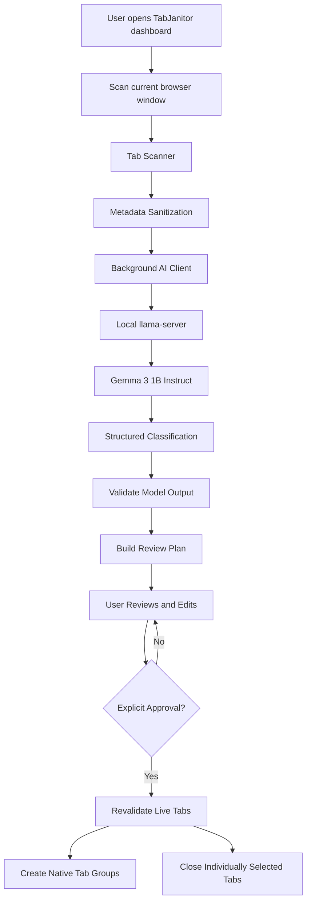

# TabJanitor 🧹
### Less Tabs. More Focus.

**TabJanitor** is a local-first AI-powered browser tab organizer that turns tab chaos into a structured workspace. It uses **Gemma 3 1B running locally through `llama.cpp`** to classify open tabs, then lets you review and edit the proposed organization before making any browser changes.

No accounts. No cloud AI API. No automatic tab closures.

> **Core principle:** AI recommends. You review. You decide what changes.

## ✨ Features

- **AI-powered tab classification** — organize tabs into Development, Study, Research, Shopping, Entertainment, Other, and Junk / Review.
- **Local Gemma inference** — run classification on your own machine using `llama-server`.
- **Human-in-the-loop workflow** — inspect classifications, change categories, and choose individual tabs to close.
- **Native browser tab groups** — apply approved categories as browser groups.
- **Privacy-first metadata handling** — send only limited, sanitized tab metadata to the local model.
- **Light and dark themes** — switch between themes in the dashboard.
- **Explicit approval** — no grouping or closing tabs during scanning or review.

## 🧠 How Gemma Is Integrated

TabJanitor uses **Gemma 3 1B Instruct in GGUF format**, served locally by `llama.cpp` through its `llama-server` executable.

Gemma acts as the classification component of the application. It receives limited metadata about an eligible tab and returns a structured classification that the extension validates before using it to build a review plan.

### Inference pipeline

1. **Prepare metadata:** the extension collects the tab title and URL-related metadata, removes query parameters and fragments from the URL, and applies length limits.
2. **Send a local inference request:** the extension's background service worker sends a request to the local OpenAI-compatible chat-completions endpoint.
3. **Classify:** Gemma proposes a category and a concise explanation, along with the structured fields required by the classifier.
4. **Validate:** application code checks the response structure, allowed categories, confidence values, and tab references. Invalid or incomplete model output must not be blindly trusted.
5. **Build the plan:** the extension creates the review plan and calculates its counts locally.
6. **Wait for approval:** the user reviews and adjusts the plan before applying any changes.

### Why use a local model?

Running Gemma locally avoids depending on a hosted AI API for classification. TabJanitor does not require an OpenAI API key or a cloud inference account for its local model workflow.

The model is not responsible for executing browser actions. **Gemma proposes classifications; the extension's trusted code controls tab grouping and closure.**

## 🏗️ Architecture



### Main components

| Component | Responsibility |
|---|---|
| `manifest.json` | Declares the Manifest V3 extension, service worker, permissions, and local endpoint access. |
| `background/service-worker.js` | Entry point for extension messages and trusted-sender checks. |
| `background/message-handler.js` | Handles status, scanning, review-plan updates, and approved application requests. |
| `background/tab-scanner.js` | Reads the current window's tabs and creates the scan snapshot. |
| `background/metadata.js` | Filters unsupported URL schemes, sanitizes metadata, and enforces limits. |
| `background/ai-client.js` | Validates local model configuration, checks readiness, and sends inference requests. |
| `background/classifier.js` | Constructs the classification request and validates model output. |
| `background/review-plan.js` | Builds and updates the editable review plan and calculates counts. |
| `background/organizer.js` | Revalidates live tabs and performs approved grouping and closures. |
| `shared/constants.js` | Defines categories, limits, message types, and error/status codes. |
| `shared/schemas.js` | Provides request/response helpers and field validation. |
| `frontend/` | Contains the dashboard, theme system, UI components, state handling, and frontend integration boundary. |

### Frontend–backend communication

The dashboard communicates with the extension service worker through `chrome.runtime.sendMessage()`. The background layer owns access to browser tabs and the local inference endpoint.

The request/response contract uses a consistent envelope:

- Success: `{ "ok": true, "data": {} }`
- Failure: `{ "ok": false, "error": { "code": "...", "message": "...", "details": {} } }`

This separation keeps UI components from directly executing browser actions or sending tab metadata to the model endpoint.

## 🔄 The User Workflow

### 1. Check model status

Open TabJanitor from the browser's extension toolbar. The dashboard checks whether the extension can communicate with the local inference service.

Scanning should remain unavailable if the required model checks fail.

### 2. Scan the current window

Start a scan to collect eligible tabs from the current browser window. TabJanitor does not scan every browser window automatically.

### 3. Review the AI-generated plan

Inspect the proposed categories, tab titles, domains, explanations, and summary counts. Unsupported browser pages are excluded from model classification.

### 4. Correct the plan

Move tabs into different categories as needed. Select individual tabs for closure only when you are sure they are no longer needed.

`Junk / Review` is a suggestion to inspect a tab, not an instruction to close it.

### 5. Apply the organization

Confirm the action through the dashboard's approval flow. The extension rechecks the relevant tabs and then attempts to create native tab groups and close only the tabs explicitly selected for closure.

If some operations fail, the application should report the partial result rather than claiming everything succeeded.

## 🔒 Privacy and Safety

TabJanitor is designed to keep classification local and browser actions under user control.

- **Local inference:** the configured model endpoint must use `127.0.0.1` or `localhost`.
- **Minimal metadata:** the model receives sanitized tab metadata, not full webpages.
- **No page-content scraping:** TabJanitor does not need page contents, cookies, browser storage, or browsing history for its classification workflow.
- **No remote inference endpoint:** the application validates the endpoint configuration and rejects non-loopback endpoints.
- **No automatic closures:** the model cannot close tabs. Closure requires explicit user selection and approval.
- **Live revalidation:** the extension rechecks tab IDs and window membership before applying changes.
- **Validated model output:** model-generated data is treated as untrusted input and checked by application code.

The extension requests these browser permissions:

| Permission | Purpose |
|---|---|
| `tabs` | Read tab titles and URLs and perform approved tab operations. |
| `tabGroups` | Create and name native tab groups. |
| `storage` | Store the local inference configuration and supported extension settings. |
| Localhost host permissions | Communicate with the local inference server. |

**Privacy scope:** tab metadata is sent to the configured local inference server. This design does not independently audit the operating system, model binary, or other software running on the machine.

## ⚙️ Setup and Usage

### Requirements

- Google Chrome with support for Manifest V3.
- The TabJanitor repository.
- `llama-server` from `llama.cpp`.
- A compatible local Gemma GGUF model.
- A machine capable of running the selected model.

### 1. Start the local Gemma server

Make sure your GGUF model is available locally and `llama-server` is installed.

Example PowerShell command for the verified local setup:

```powershell
& "$env:LOCALAPPDATA\Microsoft\WinGet\Packages\ggml.llamacpp_Microsoft.Winget.Source_8wekyb3d8bbwe\llama-server.exe" `
  --model "$env:USERPROFILE\.cache\huggingface\hub\models--ggml-org--gemma-3-1b-it-GGUF\snapshots\f9c28bcd85737ffc5aef028638d3341d49869c27\gemma-3-1b-it-Q4_K_M.gguf" `
  --host 127.0.0.1 `
  --port 8080 `
  --ctx-size 4096
```

This command uses the model path from the original development environment. If you use a different installation or model location, update the paths accordingly.

The server exposes an OpenAI-compatible chat-completions endpoint at:

`http://127.0.0.1:8080/v1/chat/completions`

TabJanitor uses this local endpoint; Ollama is not required for this setup.

### 2. Verify the server

In PowerShell, run:

```powershell
Invoke-RestMethod http://127.0.0.1:8080/health
```

The server should report a healthy status. You can also inspect the loaded model:

```powershell
Invoke-RestMethod http://127.0.0.1:8080/props |
  Select-Object model_alias, model_path, model_ftype
```

A healthy endpoint alone does not guarantee that classification requests will succeed; TabJanitor also checks whether the model can answer a test request.

### 3. Load the extension in Chrome

1. Open `chrome://extensions`.
2. Enable **Developer mode**.
3. Select **Load unpacked**.
4. Choose the TabJanitor project folder containing `manifest.json`.
5. Pin TabJanitor to the browser toolbar if needed.
6. Click the TabJanitor icon to open its dashboard.

### 4. Use TabJanitor

1. Check that model status is ready.
2. Select **Scan Window**.
3. Review the generated classifications.
4. Correct categories and select any tabs you explicitly want to close.
5. Review the changes and confirm **Apply Organization**.

If the model is unavailable, check that `llama-server` is running at the configured endpoint and that the selected model loaded successfully.

## 🧰 Configuration

The extension reads its local model configuration from `chrome.storage.local` under the key `tabjanitor.config`.

Example configuration values:

```js
{
  inferenceEndpoint: "http://127.0.0.1:8080",
  inferenceModel: "gemma-3-1b-it",
  requestTimeoutMs: 60000
}
```

These are the configuration fields, not a standalone executable configuration file. The endpoint must be a loopback HTTP base URL, without a path, query string, or credentials. The model identifier must match what the local server accepts.

## 🧪 Testing

TabJanitor's automated tests are designed to test the application logic without requiring real browser tab operations or live model inference for every test.

Important areas to test include:

- Metadata sanitization and unsupported-page filtering.
- Valid and malformed model responses.
- Unknown, missing, or duplicate tab references.
- Invalid configuration and unreachable model endpoints.
- Review-plan edits and individual closure selections.
- Stale tabs and partial failures during application.
- Explicit approval before browser mutations.

A final manual smoke test should use a real Chrome extension installation and a running local Gemma server.

Run the project's available test scripts from the repository root, using the commands defined in `package.json`. Test results should only be described as passing after they have actually been run.

## 🚧 Current Scope and Limitations

- The primary target is Chrome with Manifest V3.
- Classification quality depends on the local model and the metadata available for each tab.
- Model responses can be malformed or ambiguous, so application-side validation remains necessary.
- Unsupported browser pages cannot be classified like ordinary web pages.
- Local model performance depends on the device, model quantization, and number of eligible tabs.
- Opera compatibility has not been established solely by Chrome testing; it requires separate testing in Opera.

## 🛣️ Project Direction

TabJanitor prioritizes reliable, transparent tab organization over autonomous browser control.

The central design decision is to separate **AI classification** from **browser execution**: the model provides suggestions, application code validates them, and the user retains final control.

---

**Built for a calmer browsing workflow.**

*TabJanitor — Clutter Free, Mind Clear.*
